<p align="center">
  
</p>

<p align="center">
  <a href="https://github.com/ishandutta2007/Awesome-Awesome-Awesome"></a>
  <a href="https://discord.gg/jc4xtF58Ve"></a>
  <a href="https://github.com/ishandutta2007/Awesome-Enterprise-Cloud-Infrastructure-Management/stargazers"></a>
  <a href="https://github.com/ishandutta2007/Awesome-Enterprise-Cloud-Infrastructure-Management/network/members"></a>
  <a href="https://github.com/ishandutta2007/Awesome-Enterprise-Cloud-Infrastructure-Management/issues"></a>
  <a href="https://github.com/ishandutta2007/Awesome-Enterprise-Cloud-Infrastructure-Management/pulls"></a>
  <a href="https://github.com/ishandutta200"></a>
</p>

---

# 🌐 Awesome Enterprise Cloud Infrastructure Management

> 🚀 **The definitive curated index of Enterprise Cloud Infrastructure Management (CIM) platforms, Cloud Management Platforms (CMP), Infrastructure-as-Code (IaC) engines, multi-cloud orchestrators, FinOps monitors, and cloud governance frameworks.**

Whether you are a platform engineer architecting an internal developer platform (IDP), a cloud architect governing hybrid enterprise environments, or a DevOps lead seeking vendor-independent IaC automation, this repository provides deep, data-driven comparisons of leading **enterprise SaaS platforms** and **open-source GitHub projects**.

---

## 📑 Table of Contents

- [📊 Sector Overview & Market Dynamics](#-sector-overview--market-dynamics)
- [🏢 Enterprise SaaS & Hosted Platforms](#-enterprise-saas--hosted-platforms)
- [⚡ Open-Source GitHub Projects](#-open-source-github-projects)
- [🏗️ Enterprise Architectural Blueprint](#️-enterprise-architectural-blueprint)
- [📈 Star History](#-star-history)
- [🤝 How to Contribute](#-how-to-contribute)
- [⚖️ Disclaimer](#️-disclaimer)

---

## 📊 Sector Overview & Market Dynamics

The global **Cloud Management Platform (CMP) and Cloud Infrastructure Management** market is valued at approximately **$18.5 Billion (2024–2025)** and is projected to surpass **$55.2 Billion by 2030**, compounding at an aggressive **CAGR of ~20.4%**. 

From a market structure perspective, the sector is **bifurcated and moderately concentrated** at the infrastructure layer—where hyperscalers (Microsoft Azure, AWS, and Google Cloud) maintain an oligopoly over native cloud fabrics—yet **highly fragmented and rapidly evolving** across the vendor-agnostic orchestration, policy-as-code, and FinOps tiers. Independent innovators (such as Spacelift, env0, Morpheus Data, and open-source foundations like OpenTofu and Crossplane) capture substantial enterprise value by preventing cloud lock-in, simplifying multi-cloud compliance, and delivering unified GitOps automation across heterogeneous enterprise estates.

---

## 🏢 Enterprise SaaS & Hosted Platforms

Below is a curated comparison of leading enterprise SaaS and hosted cloud infrastructure management platforms. Entries are sorted in **descending order by company scale** (market capitalization or latest enterprise valuation).

| 🏢 Platform | 🏛️ Company Scale (Valuation / Revenue) | 🎯 Core Capabilities & Architecture | 💳 Specific Starting Pricing | 🎁 Specific Free Tier & Trial Limits |
| :--- | :--- | :--- | :--- | :--- |
| **[Azure Management](https://azure.microsoft.com/en-us/solutions/cloud-management/)** | **~$3.1 Trillion** Market Cap *(FY24 Rev: $245B)* | Native Azure governance, policy enforcement, hybrid infrastructure monitoring, patch management, and Azure Cost Management. | **$0.002 / minute** for Azure Automation runbooks; **$2.30 / GB** for Azure Monitor Log Analytics data ingestion; Azure Policy is $0 for native Azure resources. | **Free Forever**: 500 job minutes/month on Azure Automation, 5 GB Log Analytics ingestion/month, plus **30-day trial with $200 credits** and 12 months of 55+ services. |
| **[Google Cloud Deployment & Infra Manager](https://cloud.google.com/infrastructure-manager)** | **~$2.1 Trillion** Market Cap *(FY24 Rev: $350B)* | Google-managed Terraform infrastructure engine & native Deployment Manager for automated declarative cloud provisioning. | **$0.005 / deployment minute** for Infrastructure Manager engine runs; $0 base fee for native Deployment Manager (pay underlying compute). | **Free Forever**: 2,500 deployment minutes/month on Infrastructure Manager; plus **90-day free trial with $300 in credits** across GCP. |
| **[AWS CloudFormation](https://aws.amazon.com/cloudformation/)** | **~$2.0 Trillion** Market Cap *(FY24 Rev: $575B)* | Declarative JSON/YAML template provisioning, StackSets multi-account orchestrator, drift detection, and IaC Generator. | **$0.0009 / handler invocation** & **$0.00008 / handler second** for custom/third-party resource providers; $0 for native AWS resource provisioning. | **Free Forever**: Unlimited native AWS resource operations; 1,000 handler operations/month free for custom resource providers; AWS 12-month free tier. |
| **[VMware Aria / VCF](https://www.vmware.com/products/aria.html)** *(Broadcom)* | **~$780 Billion** Market Cap *(FY24 Rev: $51B)* | Full-stack private & hybrid cloud automation, intelligent IT operations AI, self-service catalog, and multi-cloud governance. | **$350 / core / year** list subscription for VMware Cloud Foundation (VCF) package (minimum 16 cores per CPU socket). | **60-day evaluation trial** of VMware Cloud Foundation / Aria Suite with full enterprise features (up to 32 CPU cores). |
| **[Salesforce Hyperforce](https://www.salesforce.com/)** | **~$280 Billion** Market Cap *(FY25 Rev: $38B)* | Hyperscale infrastructure foundation running Salesforce application stacks across global public clouds with zero-trust residency. | Included with Salesforce CRM editions starting at **$165 / user / month** (Enterprise Edition, billed annually); $0 migration surcharge. | **30-day free trial** of Salesforce Enterprise Edition (up to 5 users, complete access to cloud deployment and management console). |
| **[HCP Terraform](https://www.hashicorp.com/products/terraform)** *(HashiCorp / IBM)* | **~$215 Billion** Market Cap *(HashiCorp acquired for $6.4B)* | Managed Terraform & OpenTofu cloud workspaces, private module registry, Sentinel/OPA policy-as-code, and VCS push-to-deploy. | **$0.00014 / managed resource / hour** (~$0.10/resource/month) on Standard Tier after 500 free units; Plus tier via enterprise quote. | **Free Forever**: Up to 500 managed resources/month, 1 concurrent execution run, private registry; **30-day trial** of HCP Terraform Plus. |
| **[Morpheus Data](https://morpheusdata.com/)** *(HPE)* | **~$27 Billion** Market Cap *(HPE acquired Morpheus in 2024)* | Hybrid multi-cloud orchestrator bridging AWS, Azure, GCP, VMware, OpenStack, bare-metal, and self-service FinOps cost allocation. | **$200 / managed workload / year** (or starting at ~$20/socket/month integrated via HPE GreenLake private cloud subscriptions). | **Community Edition Free Forever**: Up to 25 managed workloads/VMs and 3 cloud integrations; **30-day full-featured enterprise trial**. |
| **[Nutanix Prism](https://www.nutanix.com/products/prism)** | **~$16 Billion** Market Cap *(FY24 Rev: $2.15B)* | Unified management plane for hyperconverged infrastructure (HCI), one-click VM/container lifecycle, and predictive capacity analytics. | **$95 / core / year** (Prism Pro tier subscription add-on; Prism Starter bundled with Nutanix Cloud Infrastructure licenses). | **Prism Starter Free Forever** with any Nutanix cluster; **30-day free Test Drive** on hosted cloud environment (no installation required). |
| **[Spacelift](https://spacelift.io/)** | **~$200 Million** Valuation *(Series B, $40M+ raised)* | Multi-IaC orchestration engine (Terraform, OpenTofu, Pulumi, CloudFormation, Ansible) with OPA policies, stack dependencies, and drift fixes. | **$250 / month** (Cloud Starter plan, includes 2 private worker concurrency seats & unlimited public workers); Business tier starts at **$750/month**. | **Free Forever**: Up to 2 users, 200 unmetered runs/month, access to public shared runners; **14-day free trial** of Business tier. |
| **[env0](https://www.envzero.com/)** | **~$100 Million** Valuation *(Series A/B, $42M+ raised)* | Multi-framework IaC management with flat monthly pricing, automated TTL ephemeral environments, budget alerts, and self-hosted agents. | **$499 / month** (Pro plan, flat fee including 10 team members, unlimited concurrent pipeline runs, and self-hosted agents). | **Free Forever**: Up to 3 users, 3 active environments, and 100 deployments/runs per month; **14-day free trial** of Pro plan with unlimited runs. |

---

## ⚡ Open-Source GitHub Projects

Explore the premier open-source cloud infrastructure platforms, control planes, and developer tools. Repositories are strictly sorted in **descending order by GitHub star count** as of recent data.

### 1. ☸️ [Kubernetes](https://github.com/kubernetes/kubernetes) [](https://github.com/kubernetes/kubernetes/stargazers)
- **License**: Apache-2.0  
- **Description**: The industry-standard declarative container orchestration system that serves as the universal control plane for modern cloud-native infrastructure across on-prem, hybrid, and multi-cloud environments.
- **Key Capabilities**: Automated rollouts, service discovery, self-healing, storage orchestration, and extensible Custom Resource Definitions (CRDs).

### 2. 🤖 [Ansible](https://github.com/ansible/ansible) [](https://github.com/ansible/ansible/stargazers)
- **License**: GPL-3.0  
- **Description**: Radically simple, agentless IT automation system handling cloud provisioning, configuration management, application deployment, and intra-service orchestration via SSH and WinRM.
- **Key Capabilities**: Human-readable YAML playbooks, 1,000+ community cloud modules, zero client-side daemons, and idempotent execution.

### 3. 🧪 [LocalStack](https://github.com/localstack/localstack) [](https://github.com/localstack/localstack/stargazers)
- **License**: Apache-2.0  
- **Description**: A fully functional local cloud stack that emulates AWS services locally on your laptop or CI environment, enabling testing of cloud infrastructure and IaC without spending real cloud dollars.
- **Key Capabilities**: Emulates 80+ AWS services (S3, Lambda, DynamoDB, SQS, IAM, CloudFormation), offline testing, and instant feedback cycles.

### 4. 🌍 [Terraform](https://github.com/hashicorp/terraform) [](https://github.com/hashicorp/terraform/stargazers)
- **License**: BSL-1.1 / MPL-2.0 (pre-1.5.6)  
- **Description**: The foundational declarative Infrastructure-as-Code tool using HashiCorp Configuration Language (HCL) to safely and predictably create, change, and improve multi-cloud infrastructure.
- **Key Capabilities**: Declarative state management, execution planning (`terraform plan`), and thousands of ecosystem providers.

### 5. 🛡️ [Trivy](https://github.com/aquasecurity/trivy) [](https://github.com/aquasecurity/trivy/stargazers)
- **License**: Apache-2.0  
- **Description**: Comprehensive and versatile security scanner covering container images, filesystems, Git repositories, virtual machine images, and Infrastructure-as-Code configurations.
- **Key Capabilities**: Scans Terraform, CloudFormation, Dockerfile, and Kubernetes manifests for known CVEs, hardcoded secrets, and misconfigurations.

### 6. 🥗 [OpenTofu](https://github.com/opentofu/opentofu) [](https://github.com/opentofu/opentofu/stargazers)
- **License**: MPL-2.0  
- **Description**: The community-governed, open-source fork of Terraform supported by the Linux Foundation. Drop-in compatible with existing Terraform configurations and providers.
- **Key Capabilities**: State file encryption out-of-the-box, early variable evaluation, community-driven roadmap, and commercial-friendly licensing.

### 7. 🟣 [Pulumi](https://github.com/pulumi/pulumi) [](https://github.com/pulumi/pulumi/stargazers)
- **License**: Apache-2.0  
- **Description**: Modern Infrastructure-as-Code SDK allowing developers to build, deploy, and manage cloud infrastructure using real programming languages: TypeScript, Python, Go, C#, Java, and YAML.
- **Key Capabilities**: Native loops and abstractions, IDE autocompletion, Pulumi ESC (Environments, Secrets & Configuration), and crossguard policy-as-code.

### 8. 💸 [Infracost](https://github.com/infracost/infracost) [](https://github.com/infracost/infracost/stargazers)
- **License**: Apache-2.0  
- **Description**: Cloud cost estimation engine for Terraform, OpenTofu, and Terragrunt pull requests, shifting FinOps left directly into developer pull requests.
- **Key Capabilities**: Real-time breakdown of monthly cost differences in GitHub/GitLab PR comments across AWS, Azure, and Google Cloud before code merges.

### 9. 📜 [Open Policy Agent (OPA)](https://github.com/open-policy-agent/opa) [](https://github.com/open-policy-agent/opa/stargazers)
- **License**: Apache-2.0  
- **Description**: An open-source, general-purpose policy engine that unifies policy enforcement across cloud-native environments, microservices, Kubernetes admission control, and CI/CD pipelines.
- **Key Capabilities**: Rego query language, high-performance in-memory evaluation, declarative guardrails, and audit logging.

### 10. 🔀 [Crossplane](https://github.com/crossplane/crossplane) [](https://github.com/crossplane/crossplane/stargazers)
- **License**: Apache-2.0  
- **Description**: CNCF graduated control plane framework that transforms your Kubernetes cluster into a universal multi-cloud control plane for managing external cloud resources.
- **Key Capabilities**: Compositions for building custom internal developer platform APIs, continuous reconciliation, and native GitOps integration.

### 11. 🧱 [Terragrunt](https://github.com/gruntwork-io/terragrunt) [](https://github.com/gruntwork-io/terragrunt/stargazers)
- **License**: MIT  
- **Description**: Flexible orchestration tool that provides extra tooling for keeping your Terraform/OpenTofu configurations DRY, working with multiple modules, and orchestrating dependencies.
- **Key Capabilities**: Remote state management automation, multi-account orchestration, CLI command hooks, and DRY input architecture.

### 12. 🔱 [Atlantis](https://github.com/runatlantis/atlantis) [](https://github.com/runatlantis/atlantis/stargazers)
- **License**: Apache-2.0  
- **Description**: Self-hosted GitOps pull-request automation tool for Terraform and OpenTofu that runs plans and applies directly from pull request comments.
- **Key Capabilities**: Pull request comments driving `atlantis plan` and `atlantis apply`, state locking per pull request, and role-based plan approvals.

### 13. 🔍 [Checkov](https://github.com/bridgecrewio/checkov) [](https://github.com/bridgecrewio/checkov/stargazers)
- **License**: Apache-2.0  
- **Description**: Static code analysis tool for Infrastructure-as-Code scanning Terraform, CloudFormation, Kubernetes, Helm, ARM Templates, and Serverless framework configs.
- **Key Capabilities**: Over 1,000 built-in security and compliance policies (CIS benchmarks, HIPAA, PCI-DSS) with automated fix suggestions.

### 14. 🗄️ [Steampipe](https://github.com/turbot/steampipe) [](https://github.com/turbot/steampipe/stargazers)
- **License**: AGPL-3.0  
- **Description**: The zero-ETL SQL engine for cloud APIs that maps live multi-cloud infrastructure and SaaS APIs directly into virtual relational Postgres tables.
- **Key Capabilities**: Query AWS, Azure, GCP, GitHub, and Kubernetes using standard SQL `SELECT` statements; pre-built compliance dashboards.

### 15. 🖥️ [KubeVirt](https://github.com/kubevirt/kubevirt) [](https://github.com/kubevirt/kubevirt/stargazers)
- **License**: Apache-2.0  
- **Description**: CNCF technology add-on that enables Kubernetes to provision, run, and manage traditional virtual machines side-by-side with container workloads.
- **Key Capabilities**: Bridges legacy VM infrastructure with modern cloud-native Kubernetes tooling; unified compute governance.

### 16. 📊 [OpenCost](https://github.com/opencost/opencost) [](https://github.com/opencost/opencost/stargazers)
- **License**: Apache-2.0  
- **Description**: CNCF open-source vendor-neutral cost monitoring and allocation tool for Kubernetes workloads, standardizing cloud infrastructure billing models.
- **Key Capabilities**: Real-time per-pod and per-namespace cost allocation, multi-cloud pricing API integration, and Prometheus metric exporters.

### 17. 🔄 [CloudQuery](https://github.com/cloudquery/cloudquery) [](https://github.com/cloudquery/cloudquery/stargazers)
- **License**: MPL-2.0  
- **Description**: High-performance open-source ELT framework for cloud infrastructure and security assets, extracting cloud configurations into PostgreSQL, Snowflake, or BigQuery.
- **Key Capabilities**: Hundreds of source and destination plugins, asset inventory synchronization, and custom drift analytics.

### 18. 👮 [Cloud Custodian](https://github.com/cloud-custodian/cloud-custodian) [](https://github.com/cloud-custodian/cloud-custodian/stargazers)
- **License**: Apache-2.0  
- **Description**: Rules engine for multi-cloud management that enforces real-time cost containment, garbage collection, tag compliance, and security policies via simple YAML.
- **Key Capabilities**: Event-driven serverless policies (AWS CloudWatch, Azure Event Grid, GCP Audit Logs) that execute automated remediation actions.

### 19. ⛏️ [Digger](https://github.com/diggerhq/digger) [](https://github.com/diggerhq/digger/stargazers)
- **License**: Apache-2.0  
- **Description**: Open-source IaC orchestrator that runs Terraform and OpenTofu natively inside your existing CI system (GitHub Actions, GitLab CI) instead of requiring a separate SaaS runner.
- **Key Capabilities**: Native CI pipeline execution, pull-request concurrency locking, drift detection, and role-based RBAC without sharing cloud credentials.

### 20. 🧩 [Cluster API](https://github.com/kubernetes-sigs/cluster-api) [](https://github.com/kubernetes-sigs/cluster-api/stargazers)
- **License**: Apache-2.0  
- **Description**: Kubernetes Special Interest Group (SIG) project that brings declarative, Kubernetes-style APIs to cluster creation, configuration, and management across public clouds and vSphere.
- **Key Capabilities**: Declarative cluster lifecycle management, rolling machine upgrades, and provider implementations for AWS (CAPA), Azure (CAPZ), GCP (CAPG), and vSphere (CAPV).

### 21. 🗺️ [Cartography](https://github.com/lyft/cartography) [](https://github.com/lyft/cartography/stargazers)
- **License**: Apache-2.0  
- **Description**: Python-based infrastructure asset consolidation tool that maps technical assets and security dependencies across AWS, GCP, and Kubernetes into a Neo4j graph database.
- **Key Capabilities**: Graph-based relational exploration of attack paths, cloud permissions, cross-account trusts, and unattached network assets.

### 22. 🧭 [Driftctl](https://github.com/snyk/driftctl) [](https://github.com/snyk/driftctl/stargazers)
- **License**: Apache-2.0  
- **Description**: Free and open-source CLI tool that tracks and alerts on cloud infrastructure drift by comparing your actual AWS/Azure/GCP cloud configurations against your codified IaC state.
- **Key Capabilities**: Identifies unmanaged and rogue cloud resources created through consoles or scripts, reducing security exposure and blind spots.

---

## 🏗️ Enterprise Architectural Blueprint

For organizations constructing an autonomous, vendor-independent **Enterprise Cloud Infrastructure Management Platform**, consider this modular architectural pattern:

```text
┌────────────────────────────────────────────────────────────────────────┐
│                   INTERNAL DEVELOPER PLATFORM (IDP)                    │
│      Backstage / Port / Self-Service Catalog & Provisioning APIs       │
└───────────────────────────────────┬────────────────────────────────────┘
                                    │
┌───────────────────────────────────▼────────────────────────────────────┐
│                    IAC ORCHESTRATION & GITOPS LAYER                    │
│        Atlantis / Digger / Spacelift / env0 / HCP Terraform            │
└───────────────────────────────────┬────────────────────────────────────┘
                                    │
┌───────────────────────────────────▼────────────────────────────────────┐
│                  PROVISIONING & CONTROL PLANE ENGINES                  │
│       OpenTofu / Terraform / Pulumi / Crossplane / Cluster API         │
└───────────────────┬───────────────────────────────┬────────────────────┘
                    │                               │
┌───────────────────▼─────────────┐   ┌─────────────▼────────────────────┐
│     GOVERNANCE & SECURITY       │   │         FINOPS & DRIFT           │
│  OPA / Checkov / Trivy /        │   │  Infracost / OpenCost /          │
│  Cloud Custodian / Steampipe    │   │  Driftctl / Steampipe            │
└───────────────────┬─────────────┘   └─────────────┬────────────────────┘
                    │                               │
┌───────────────────▼───────────────────────────────▼────────────────────┐
│                  MULTI-CLOUD INFRASTRUCTURE FABRICS                    │
│    AWS • Microsoft Azure • Google Cloud • VMware / On-Prem Bare-Metal  │
└────────────────────────────────────────────────────────────────────────┘
```

---

## 📈 Star History

[](https://star-history.dera.page/#ishandutta2007/Awesome-Enterprise-Cloud-Infrastructure-Management&type=date&legend=top-left)

---

## 🤝 How to Contribute

Contributions from platform engineers, DevOps leads, and cloud architects are warmly welcome!

1. 🍴 **Fork the repository** on GitHub.
2. 🌿 **Create a descriptive branch**: `git checkout -b feature/add-new-platform`.
3. 📝 **Add or update entries**:
   - For **SaaS platforms**: Include exact starting pricing, precise free tier/trial limits, and company scale.
   - For **Open-Source projects**: Provide the GitHub star social badge (`style=social&color=white`), license, and direct link to stargazers.
4. 🧪 **Ensure consistent formatting** and preserve accurate descending sort orders.
5. 🚀 **Submit a Pull Request** with a concise summary of changes.

---

## ⚖️ Disclaimer

- This repository is a community-curated, independent directory and does not constitute an endorsement or commercial warranty.
- Enterprise cloud infrastructure platforms handle privileged IAM credentials and manage production environments; always apply the principle of least privilege (PoLP), role-based access control (RBAC), and automated policy gates.
- Pricing metrics, license tiers, and market data are accurate as of latest published records and are subject to vendor updates.

---

<p align="center">
  <sub>Built with ❤️ for platform engineers, cloud architects, and DevOps practitioners worldwide.</sub>
</p>
